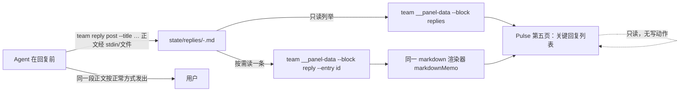

# E15 · Pulse 关键回复页：入口与复用机制探索

agent: dev2   status: delivered（探索完成；未实现、未建 change、未跑全量门禁）   time: 2026-10-09T03:27:00Z
branch: `task/E15-pulse-key-replies-explore`   PR/MR: -（本仓库是 local 模式，分支留本地）

## Deliverables

| Path | What |
|---|---|
| `docs/team/reports/E15-dev2.md` | 本报告；本任务在仓库内唯一的写入 |
| 仓外证据目录 `pm-skills-ledger/team/reports/E15-dev2/` | 全部实测输出（rc 与原始文本）、探针脚本、隔离夹具；不进仓库、不随分发 |

问题来自真实使用反馈：PM 的实质答复、以及需要用户确认的消息，会被随后的自动消息与响应埋没，用户要翻很长的历史才能找到。
用户已经选定方向并批准进入探索与提案：**在现有 Pulse 面板增加关键回复查看页面，Agent 在回复前通过工具或 team CLI 主动发布当前关键回复正文**。
降噪不做、不另造审批/待办系统。本任务只做限定范围的只读探索，报告之外的 source/spec 一律只读，没有实现、没有创建 change。

## 摘要（结论先行）

推荐把这件事落成三件套，全部建立在现有机制上，不新造 TUI、不新造消息平台：

1. **一个只写不送的 CLI**：`team reply post --title <单行标题> [--body-file <文件>] [--from <名字>]`（正文默认从 stdin 读），
   把正文原子地写进本项目运行态 `state/replies/`，打印该条的稳定编号与落盘路径；失败非零退出并给一行原因。
   它不投递、不碰 tmux、不读聊天历史、不做重要性判断。Agent 发布之后，仍按正常方式把同一段正文发给用户。
2. **一个面板第五页「关键回复」**：复用现有四页组成、页签与页位记忆、`team __panel-data` 的“一块一子进程、异步、bounded”数据栈、
   以及 detail viewer 的只读 markdown 渲染器；条目按最新在前列出（编号、时间、作者、标题），Enter 打开正文（复用同一个渲染器），
   Esc/q 返回。不提供任何写操作。
3. **总览页一行入口**：总览页显示最新一条关键回复的编号、时间与标题，以及已发布的总条数（不引入未读状态）；点它或按 `5` 进入第五页。
   这一行是“从哪里找”的固定答案，不做提醒、搜索或已读状态。

关键证据（全部在仓外证据目录，命令与输出抄录在 §5）：detail 数据块的“按 id 只读发现 + 拒绝集外路径 + 128 KiB 截断”实测通过；
`sanitizeDeep → markdownMemo` 这条显示链实测能剥掉 ESC 且保留可见文本（把 sanitize 拿掉后 ESC 会进入帧，反向也测了）；
`state/panel-page` 目前只认 `1`–`4`（写 `5` 会被回落，实测）；机器出口（`--print`/`--json`）在隔离夹具里前后都不创建 `state/` 目录。

主要成本与冲突：面板源码与 `panel.js` 必须和 `task-model-routing` 的 S2（面板实现切片）**单写者串行**；
新增第五个页签会改动现有 20 个布局快照文件与 `panel-b3.sh` 的页位夹具，这部分是本次改动最重的测试面。
功能本身尚不存在，因此本报告不宣称“已经可用”，也没有做真实渲染体验的结论。

## 1. 任务、方法与边界

- 阅读顺序按任务书执行：`AGENTS.md` → 自己线程最后条目 → 任务书 → `OWNERSHIP.md` → D104 →
  `skills/teamsmith/references/openspec.md` → `openspec/specs/panel/spec.md` 全文（2350 行）→
  相关 `notify-and-inbox` / `memory-and-deps` / `boundary` 规格 → 面板与 CLI source。
- 实测方法分三类，互不混淆：
  1. **读源码/规格**（证据是文件路径与行号，可复核）；
  2. **只读实测**：用 PM 主检出的控制 CLI（`<主检出>/skills/teamsmith/scripts/team`）跑 `__panel-data`、`monitor --print/--json`；
     真实项目上只做读取，不做任何写操作；
  3. **仓外夹具**：在证据目录里建一个自己的 git 小仓库，先用 `team paths` 证明 `main_root` 就是它，再跑会读盘的命令；
     探针脚本用 `bun` 直接 import 面板源码（纯函数），不启动 tmux、不改任何偏好。
- 全程没有启动 tmux 原型、没有在现有 `teamsmith:pulse` 窗口里做实验、没有安装依赖、没有推送。
- 本仓库是 local 模式：报告提交在任务分支上，分支留本地，由 PM 复验后合并。

## 2. 现状清点：可复用的入口与证据位置

### 2.1 四页组成与页位记忆（新增页最先触及的规格）

对应规格 `openspec/specs/panel/spec.md` 的
`### Requirement: The console composes four pages and remembers the position`（任务书 `specs:` 里的锚点）：

- 面板是“总览 / 工作 / 消息与日志 / 看板”四页加设置浮层；`Tab` 与 `1`–`4` 切页；
  当前页写 `state/panel-page`，启动时恢复；文件里是 `1`–`4` 之外的值时回落到默认页而不是报错；
- 页是 TUI 概念，`--print`/`--json` 只渲染总览内容。**新增关键回复页会修改的正是这一条 requirement。**
- 触点（改第五页必须动的全部位置，均已核对代码）：
  - `panel/src/types.ts`：`export type PageId = 1 | 2 | 3 | 4`；
  - `panel/src/settings.ts`：`pageOf()` 只接受 `'1'`–`'4'`；`readPage()` 未命中就回落；`writePage()` 不做校验；
  - `panel/src/main.tsx`：`--page` 在三处按 `1`–`4` 解析（行 293、338 与 usage 文本）；
  - `panel/src/App.tsx`：`page-cycle`（第四页后回 `1`，行 2017）、数字键 `1`–`4`（行 2020）、设置里的默认页循环（行 750）、
    Tab 的动作处理（行 1428）；
  - `panel/src/layout.ts`：`pageDefinitions()` 的 `switch (ctx.view.page)` 与 `pageTabsBlock()` 的四个页签；
  - `panel/src/strings/{zh,en}.ts`：`pageOverview` / `pageWork` / `pageMessages` / `pageBoard` 与 `pageTab` / `pageTabActive` 模板；
  - `skills/teamsmith/tests/snapshots/`：20 个快照文件的第二行就是页签行，加页签会改全部 20 个（见 §9 成本）；
  - `skills/teamsmith/tests/panel-b3.sh`：`pages · 三页 + panel-page 记忆` 一节断言按键切页、重启恢复、越界回落。

实测（证据 `25-page5-probe.txt`）：把 `5` 写进 `state/panel-page`，今天读出来是回落的 `1`；
写 `4` 读出 `4`。也就是说，若不改 `pageOf`，第五页的页位记忆会**静默丢失**。这条是本页改动的最小闸门。

### 2.2 面板数据帧：一块一子进程、按需块、bounded

- `panel/src/data.ts` 是面板唯一的数据路径：每个块一个 `team __panel-data --block <名字>` 子进程，
  每块有独立 TTL 与超时；某块源坏、超时或无输出时只把那一块画成 `—`，不影响整帧（规格
  `Frame assembly is asynchronous, cached and never blocks input`）。
- 块的名单在 `data.ts` 的 `BLOCK_NAMES`；机器出口（`--print`/`--json`）只装配 `MACHINE_BLOCKS`，
  **不读**页面专属块（`board`、`changes`、`specs`、`decisions`、`outbox_list`、`inbox`、`patrol`、`health`），
  也永远不读按需块（`detail`、`settings`）——后两者只有在对应视图打开时才加入 wanted 集，关闭时保留缓存不再重建。
  实测（`24-fixture-machine-exits.txt`）：隔离夹具里 `monitor --json` 与 `monitor --print` 都 rc=0，
  前后 `state/` 目录都不存在；真实项目上 `--json` 顶层键恰为 `["activity","panel"]`（`22-monitor-json.json`）。
- 块的分发与实现都在 `skills/teamsmith/scripts/lib/cmd-watch.sh`：`team_panel_block()` 的一个 `case` 一行，
  每个块一个函数；`detail` 与 `settings` 就是“按需块”的两个先例（`team_panel_detail_json()` / `team_panel_settings_json()`）。
- 新页应当新增一个 console-only、按需文本的块（建议 `replies` 列表 + `reply` 单条），**不进入** `MACHINE_BLOCKS`，
  这样机器出口的字节不变。

### 2.3 只读 detail viewer：发现规则、拒绝规则、渲染器、128 KiB 上限

规格 `### Requirement: A focused card opens a read-only markdown detail view` 的既有约定（本页应复用的是它，而不是重新造一个 viewer）：

- 发现面按入口 id 只读发现：`docs/team/tasks/<ID>-*.md`、`docs/team/reports/<ID>-*.md`（只认文件）、
  `docs/team/reviews/<ID>.md` 与 `docs/team/reviews/<ID>-*.md`；`<ID>` 后必须是 `.` 或 `-`，`P1` 不会匹配 `P17`；
- `--file` 只服务发现集里的路径，其他路径非零退出且不打印内容（实测两条拒绝，见 §5）；
- 正文上限 128 KiB（超出截断并带 `truncated` 标记），UTF-8 用 `iconv -c` 收尾；
- 渲染器是 `panel/src/markdown.ts` 的 `markdownMemo(path, source, width)`：ATX 标题、围栏代码块、管道表格、
  列表、引用、行内粗体/代码/链接，子集之外按原文输出；带内容指纹的 memo（上限 6 条），重绘不重复解析；
- 视图只读、不增加动作键；数据块按需构建（视图打开才请求），首帧预算 1 秒。

另一个可复用的先例是消息页的队列块：`layout.ts` 的 `queueBlock` 已经有“列出条目 + 打开其中一条的全文（只读、净化）”模式，
键位与返回规则（`viewEntry`、`queueBackHint`）可以照搬；但关键回复的正文是 markdown，渲染应换成 detail 的 `markdownMemo`，
而不是队列的逐行截断显示。

实测（`16-fixture-P1.json`、`17/18-refuse*.err`、`19-fixture-P2-big.json`）：夹具里 `P1` 发现 4 个文件、不含 `P17` 诱饵；
`--file ../../BOARD.md` 与 `--file docs/team/tasks/P17-b.md` 都 rc=1、零字节输出；
204841 字节的报告读出 `truncated: true`、正文 131072 字节、耗时 179 ms。
渲染链与净化链的实测见 §5（`20-reuse-probe.txt`、`26-sanitize-flip.txt`）。

### 2.4 只读边界：面板能写什么、有哪些动作

规格 `### Requirement: The console is read-only except through its owning commands` 把面板的写面收得很紧：

- 面板只通过四条“调用所属命令”的路径改状态：`m`/Enter → `team draft send`，`f` → `team outbox flush`，
  `s` → `team standby on|off`，设置视图确认 → `team config set`；
- 面板进程自己只写三个文件：`state/draft.md`、`state/panel.conf`、`state/panel-page`；
- v1 不新增第五个动作；`team config set --dry-run` 算读。

关键回复页**不新增动作**：它只有导航（进页、滚动、打开、返回），正文由 Agent 在面板之外通过 CLI 写入。
数据块本身也是只读读盘，因此这条 requirement 不需要为它开口子。

### 2.5 zh/en 字符串表与门禁

- 所有可见文本来自 `panel/src/strings/{zh,en}.ts` 两张表；表由 `panel/src/strings/index.ts` 的 `TABLES` 单一入口选择，
  布局只接收 `Strings` 对象，切换语言就是重绘。`keyLabel()` 给契约键提供 zh/en 标签。
- 门禁 `skills/teamsmith/tests/panel-strings.mjs` 断言：两张表键集合相同、占位符集合相同、值非空、
  面板源码 `strings/**` 之外不出现 CJK 正文、契约键标签与命令 schema 双向一致、分组标签双向一致。
  新增页的每个可见字（页签名、行模板、空态、失败态）都要进两张表，否则这段门禁直接红。
- 新页还要遵守 `Every key affordance is also a mouse target`（面板里每个有 chip 的键都要有点击目标；
  `r` 与 `pageUp/pageDown` 是规格写明的两个例外）与 `State is never carried by color alone`（状态同时用字形/文字表达）。

### 2.6 已有的消息落盘机制，以及为什么都不适配

| 现有机制 | 它是什么 | 为什么不能直接当关键回复存储 |
|---|---|---|
| `state/outbox/` + `team outbox flush`（delivery-guard） | 给 Agent→Agent/PM 的**投递队列**：一条消息一个不可变条目，排干后 `rm`，超时/受阻转 `held/` | 会被排干、移动、扣住；关键回复是给人长期回看的只增记录，不能被投递语义搬走 |
| `docs/team/inbox/<agent>.md`、`docs/team/threads/<agent>.md`（notify-and-inbox） | 按**收件人**组织的 Agent↔PM 往来记录；`team notify` 需要收件人是席位 | 用户不是席位、没有 inbox 文件；把用户塞进席位体系会污染身份与唤醒语义 |
| `state/draft.md` + `team draft send`（delivery-guard 的人侧） | 人 → PM 的草稿文件契约 | 方向相反，且内容交给投递守卫，不是归档 |
| 活动列（`monitor.mjs` 读 Pi 会话文件，`TEAM_AGENT_LOG_GLOB`） | 读最新 Pi 会话文件的**尾部**，抽 `user`/`say`/`out` 事件，默认 4 条、tail 64 KiB | 它是 bounded 的实时窗口，不是归档；数据在 `~/.pi` 会话里而不是本项目运行态；用它等于“自动从聊天历史提取”，正是任务书否掉的路线 |

结论：需要一个新的、只增不减、项目作用域、运行态（不进公开仓）的存储；投递/唤醒语义一概不掺。

## 3. 推荐方案

### 3.1 最小 CLI 接口

```
team reply post --title <单行标题> [--body-file <文件>] [--from <名字>]
    # 正文默认从 stdin 读；成功打印稳定编号 + 条目 id + 落盘路径
    # 失败：非零退出 + 一行原因（不写半截文件、不重试、不提示“已送达”）
```

语义与理由：

- **只发布，不发送**。命令的成功只代表“面板能看到这段正文”，不代表 Pi/PM 已经把回复发给了用户。
  发出动作仍在 Agent 正常回复的那条路上，用同一段正文完成；命令的任何输出都不得出现 delivered/sent 之类的词。
- **正文从文件或 stdin 进，不从 argv 进**：避免引号/长度问题，让“发布的那段文本”和“随后要发的文本”是同一个来源字节。
- **作者**：复用 `team_sender_resolve`（`lib/common.sh:717`，`team notify` 用的就是它）——
  显式 `--from` 优先，其次按运行时目录（主检出 `pm`、`.worktrees/<席位>` 解析出席位名），
  主检出入队时带席位线索则照 notify 的规则拒绝而不是猜。这样不新造第二套身份系统。
- **标题**：必填；写入前单行化（CR/LF → 空格）、去首尾空白、拒绝空标题、超长按可见宽度截断并打印提示。
  标题是头字段，**必须**单行化，否则头会被正文换行破坏。
- **正文**：写入前拒绝超过 128 KiB 的正文（与 detail viewer 同一个上限），拒绝含 NUL 字节的正文；
  拒绝时一个字节都不落盘。存储不做静默截断，读侧仍然按上限截断并带标记（防御旧文件）。
- **审计**：`state/replies/post.log` 一行一次尝试（时间、作者、结果 ok/refused/error、原因、条目 id），
  风格对齐 `state/config.log` 的 `result=…`（memory-and-deps 的“Every attempt is audited in one line”）。
  面板不渲染这条日志；它的作用是“发布失败”不是隐性事件。
- **失败不阻断答复**：CLI 非零退出并把原因写在 stderr 一行；Agent 的指引是“发布失败就继续正常回复”，
  不做重试循环、不弹窗、不把面板页变成错误页。

### 3.2 工具封装选择

| 方案 | 形态 | 成本/风险 | 结论 |
|---|---|---|---|
| **A（推荐）只用 CLI** | Agent 通过自己的 bash 工具调用 `team reply post` | 零新扩展、零启动参数变化；对任何 Agent CLI（含非 Pi 适配）一致；文档一条 | 采纳 |
| B（可选，延后）CLI + 薄 Pi 工具 | 新 `extension/team-key-reply.ts`，`pi.registerTool()` 注册一个只调 CLI 的工具；PM 启动参数加 `-e` | 技术可行（PM 已加载 `team-bg`/`team-inbox-watch` 两个扩展；`pi.registerTool` 的 name/description/parameters/execute 就是薄封装），但要改 `common.sh` 的 `team_pm_pi_args`（该文件属于 `task-model-routing` S1 的写面），PM 要重启才生效，非 Pi Agent 仍要 CLI | 暂不采纳；若真实使用显示“Agent 会漏调”，再单独立 brief |

对 B 的硬约束（如果将来要做）：工厂函数里不建 timer/watcher/进程；只注册工具，execute 里 spawn 的就是 `team reply post`；
不接管 Pi 消息历史、发布钩子、推理内容，也不碰投递路径；工具返回必须照抄 CLI 的“仅发布”语义。
已通读本机 `docs/extensions.md`（274 行）；SDK 文档与本题无关（不做程序化嵌入），未展开。

### 3.3 最小存储与只读数据路径

存储（运行态，项目作用域，默认不进公开仓）：

```
$TEAM_STATE_DIR/replies/                 # 默认 <项目>/.pi/team/state/replies/；.pi/** 已被 .gitignore 整个忽略
  <epoch-ms>-<seq>.md                    # 一条 = 一个不可变文件；按名字排序即时间序；同毫秒靠 seq 避撞
  post.log                               # 一行一次发布尝试的审计
  .lock/                                 # mkdir 锁，写名与分配编号时持锁
```

文件格式（沿用 outbox 的“头 + `---` + 原文”形状，头的每个字段一行）：

```
no: 12
id: 1791516123456-0001
author: pm
title: 下一步需要你确认的两件事
created: 2026-10-09T03:21:41Z
---
<正文原文，一个字节不改>
```

- **编号 `no`**：持锁时取 `max(已有 no) + 1`，从 1 开始。它是稳定的（新条目不会改变旧条目的号），
  展示与引用都用它；条目 id（文件名主干）用于精确定位。
- **作者/标题/时间/原文**齐全进头与文件；正文之外的元数据一律单行字段，避免解析歧义。
- **原子写**：写 `.<name>.tmp` 再 `mv`，全部在锁内；除非锁拿不到或写失败，正常情况下不会出现半截条目。
  先例是 outbox 的 enqueue（`lib/outbox.sh`：`team_outbox_lock` + tmp + `mv -f`）。
- **并发**：两个 Agent 同时发布 → 锁内分配不同的 `seq` 与 `no`，两条都在；不合并、不覆盖。
- **“展示最新标题不能覆盖旧条目”**：所有条目只增不改；打开旧条目时读的是它自己的文件。
- **重启后的读取**：状态目录落在磁盘上，面板重启后重新列出；不依赖任何内存缓存。
- **保留策略**：v1 不做自动删除，也没有删除动作（用户方向里没有待办/审批系统）；
  列出条数用 `TEAM_REPLY_KEEP`（建议默认 100）限制，多出来的以隐藏计数暴露，老条目仍然读得到。
  真正的 GC 若要，另立 change。

只读数据路径（面板侧）：

- 列表：`team __panel-data --block replies` → `{"entries":[{"id","no","author","title","created","size"}...], "total":N, "kept":M}`，
  按最新在前；只读文件的头（`head -c` 一级的有界读），**不把正文带进帧**。
- 单条：`team __panel-data --block reply --entry <id>` → `{"id","no","author","title","created","text","truncated"}`；
  `--entry` 必须命中列表里的条目（先做字符白名单，再在目录枚举里比对），任何路径形状都不服务——
  与 detail 的 `--file` 拒绝同形（实测过 detail 的两种拒绝）。
- 正文上限同为 128 KiB；超出截断并给标记。
- 两个块都是 console-only，且 `reply` 是按需块（第五页打开某条时才请求），空闲的脉冲窗口不为它花子进程。

### 3.4 页面与交互



用户的实际路径：打开 Pulse → 在总览页第一行的“关键回复”入口看到最新一条的编号/时间/标题 → 按 `5`（或点页签）进入第五页 →
`↑`/`↓`（或鼠标滚轮）选到要找的答复 → Enter 读整段正文，读完 Esc/q 回到列表。
- **页与入口**：新增第五页（建议页签 `关键回复` / `key replies`），键 `5`，Tab 循环到第五页；
  `state/panel-page` 接受 `1`–`5`，越界回落默认页。总览页加一行“关键回复”入口：最新一条的编号、时间、标题与总条数，
  点击/回车进入第五页。主入口是**常驻的页签**（一直可见、一键可达），总览那一行解决“今天有没有新的实质答复”这个问题，
  两者都不引入提醒、未读或搜索。
- **列表**：最新在前，每行 `#编号 · 时间 · 作者 · 标题`（窄屏先丢作者与完整时间，标题最后截断，与看板卡片的降级顺序一致）；
  `↑`/`↓` 移动焦点、Enter 打开正文，点击遵循现有点击规则（第一次点聚焦、第二次打开，与看板一致）。
- **正文**：复用 detail viewer 的窗口机制与 `markdownMemo` 渲染（标题、表格、围栏、列表、引用、链接）；
  `Esc`/`q` 返回列表页，不收起控制台；正文只读，没有动作键。
- **不做**：降噪、确认状态机、提醒/搜索平台、跨页跳转、编辑/删除、把内容转发给其他 Agent。

### 3.5 空、失败、窄屏、长文

| 状态 | 表现 |
|---|---|
| 空（还没有条目） | 列表画一行暗色空态（两张字符串表各一条），不画焦点、不注册动作 |
| 存储不可读 / 块失败 | 与其它块一致：那块画 `—`，其余块照常渲染；日志里保留失败原因 |
| 发布被拒 | CLI 非零 + 一行原因 + 审计行；面板不显示错误页（面板只读已成功落盘的事实） |
| 窄屏（<60 列） | 每行一条：编号 + 标题（时间可选），页签仍不越界；四档布局的既有降级顺序照用 |
| 长文（>128 KiB 或超过一屏） | 存储写侧拒绝超过 128 KiB；读侧对旧文件截断并带标记；一屏放不下时按 detail 的窗口规则滚动 |

### 3.6 存储原文与安全显示的分工

- **存储原文**：CLI 写盘的内容就是 Agent 给的正文；除标题单行化与上限拒绝之外不做改写。这样面板展示的不是“二次加工过的摘要”。
- **安全显示**：所有从磁盘读出的字符串都经过数据层 `data.ts` 的 `sanitizeDeep`（每块的 JSON 解析后统一净化），
  再经 `markdownMemo` 渲染；控制字节被剥掉但可见文本保留（规格 `Display safety: sanitize before layout, and keep the visible text`）。
  实测：净化后渲染无 ESC 且 `safe/MORE/END` 等文本都在；不做净化时 ESC 会进入行（§5 的反向实测）。
- 标题同样走这条链；不因为“标题短”而跳过净化。

## 4. 备选与取舍

| 备选 | 不推荐的理由 |
|---|---|
| 复用 `state/outbox/` | 队列语义（排干、转移 `held/`、上限升级）会搬走条目；它不是“回看归档” |
| 落在 `docs/team/reports/**` 或别的仓库路径 | 会进公开仓/分发面，违反“原文默认不入公开仓” |
| 从 Pi 会话日志自动提取 PM 的回复 | 自动提取正是任务书否掉的路线（不读聊天历史、不做重要性分类）；且会话数据不在项目运行态 |
| 把关键回复做成消息页（第三页）的一个块 | 消息页已有队列/收件箱/巡检/容量四块；排上去仍会被淹，且没有独立页签这个稳定入口 |
| 第六页以外的更多视图（设置浮层那样的子视图） | 设置浮层是“改配置”的场景；关键回复是独立阅读场景，独立页最省心，也最符合用户“增加关键回复查看页面”的原话 |
| 做成 `docs/team/**` 里的账本条目 + 面板读账本 | 账本是公开仓库内容；且需要“人写账本”的语义，与 Agent 发布正文的用途不符 |

## 5. 实测记录（真实命令与输出摘要）

全部原始输出在仓外证据目录（文件名见附录 A）。运行环境：控制 CLI = PM 主检出的 `skills/teamsmith/scripts/team`（teamsmith 0.1.1），
cwd = 我的任务工作树或仓外夹具；夹具命令都显式清掉继承的 `TEAM_*` 身份。

### 5.1 任务书的记录检查（本报告存在之前跑的基线）

| # | 命令 | rc | 结果 |
|---|---|---|---|
| 1 | `bun openspec context --json` | 0 | 根指向我的工作树；`members`/`status` 为空 |
| 2 | `bun openspec validate --all --strict` | 0 | 13 个 spec + 1 个 pending change，14 passed / 0 failed |
| 3 | `bash skills/teamsmith/tests/spec-refs.sh --check` | 0 | judged 104 references（49 distinct）；retired 0；undeclared 0 |
| 4 | `bash skills/teamsmith/tests/ledger-ban.sh --names-file …` | 0 | scope=published files=1309 hits=0 |
| 5 | `git diff --check` | 0 | 无输出 |
| 6 | `bash skills/teamsmith/tests/section-select.sh --paths docs/team/reports/E15-dev2.md` | 0 | `decision=NONE`（docs/* 是豁免类，本报告不触发任何门禁段） |

### 5.2 复用点实测（读只读路径；夹具在仓外）

| # | 探针 | 命令要点 | rc | 关键输出 |
|---|---|---|---|---|
| 7 | 真实项目 detail 读 | 控制 CLI `__panel-data --block detail --id E15`（主检出） | 0 | count=1，发现任务书自身；JSON 形状 `{id,count,file,text,truncated,files[]}` |
| 8 | 夹具隔离证明 | 夹具里 `team paths`（清空继承身份） | 0 | `main_root` = 夹具目录，docs = 夹具 `docs/team` |
| 9 | 发现规则 | 夹具 `--block detail --id P1` | 0 | 4 个文件：`P1-a.md`/`P1-dev.md`/`P1.md`/`P1-done.md`；`P17-b.md` 诱饵未出现 |
| 10 | 路径拒绝 | 夹具 `--file ../../BOARD.md` / `--file docs/team/tasks/P17-b.md` | 1 / 1 | 0 字节输出；stderr 点名“不在发现集里” |
| 11 | 正文上限 | 夹具 204841 字节报告 `--id P2` | 0 | 179 ms；`truncated:true`；正文 131072 字节（128 KiB） |
| 12 | 净化 + markdown 链 | `bun` 探针：`sanitizeDeep` → `markdownMemo(width=60)`，敌意样本含 OSC52/`ESC[2J` | 0 | 16 行；无 ESC；`safe/MORE/END/bold/code/item two` 都在；表格对齐、围栏、列表、引用都渲染 |
| 13 | 反向（去掉净化） | 同上但直接喂 `markdownMemo` | 0 | ESC 出现在行里（`esc_in_rows_without_sanitize: true`）——净化是承重的 |
| 14 | 页位范围 | `bun` 探针 `readPage()` | 0 | `4→4`；`5→1`（回落）；`1→1` |
| 15 | 机器出口隔离 | 仓外夹具 `monitor --json` / `--print` | 0 / 0 | 578 ms / 563 ms；前后 `state/` 都不存在；JSON 顶层键 `["activity","panel"]`；缺数据的块画 `—` |
| 16 | 真实项目机器出口 | 主检出 `monitor --json` / `--print` | 0 / 0 | 输出形状正常（顶层键与面板字段齐全）；**没有**当作隔离证据——真实项目的 `state/` 在测量窗口内本来就被在跑的 pulse/其它席位持续写（对照：不跑命令的空窗 6 秒里 `capacity.log`/`watchdog.tick.log`/`inbox-watch/*.reg` 同样在变），所以只用于看输出形状 |

### 5.3 没有测的

- 没有实现，所以没有关键回复页/CLI 的任何行为测试；不拿本次源码分析当作体验结论。
- 没有跑全量 smoke、没有跑真 pty 面板夹具、没有看真实 TUI 渲染。
- 没有验证 Pi 工具封装（方案 B）在真实 PM 会话里的加载与调用；只核对了本机文档与仓库内已有扩展的注册形态。

## 6. 下一阶段的反例清单（能让未来实现失败）

这些是给 propose 阶段写 scenario/夹具用的“必须能红”的检查，不是新的需求清单：

**写入侧**
1. 同一毫秒并发两次 `post` → 必须有两个不同条目、两个不同 `no`，没有覆盖。
2. 正文 128 KiB + 1 字节 → 必须拒绝（非零 + 原因），`state/replies/` 不新增文件、不留 `.tmp`。
3. 正文含 NUL → 必须拒绝。
4. 标题带 CR/LF → 必须单行化后落盘，头字段完整，后续条目可解析。
5. `state/replies/` 不可写（只读目录）→ 非零 + 点名路径；`post.log` 留下失败行（若采纳审计行）。
6. 从 `.worktrees/dev2` 发布且不显式 `--from` → 作者是 `dev2`；主检出发布是 `pm`；显式 `--from` 与目录冲突按 notify 规则处理。
7. 发布只写 `state/replies/**`：跑前后对项目其余路径取哈希，必须不变（只读纪律的反向守卫）。

**读取侧**
8. `--entry ../../BOARD.md`、`--entry ../x`、`--entry <不存在的 id>` → 三种都非零、零字节输出。
9. 一条条目被手工截断/损坏 → 列表不崩，那一行降级可见，其余条目照常。
10. 128 KiB 以上旧文件 → 读侧截断 + `truncated` 标记（复用 detail 的既有形状）。

**页面**
11. `state/panel-page` 写 `5` → 第五页；写 `6`/`0` → 回落默认页（现状 5 会回落，见 §5 #14，这条是翻转点）。
12. Tab 从第四页到第五页再到第一页；`5` 直达第五页。
13. 新增页签后 20 个快照重生成，四档 × 两主题仍全绿；59/60 列等边界页签不越界、键带仍是最后一行。
14. 空存储 → 空态行；块失败 → `—`；没有焦点与动作注册。
15. 敌意标题/正文（OSC/CSI）→ 帧内无 ESC 且可见文本保留（去掉净化必须让这条红，已做反向实测）。
16. 打开正文前后 `state/`、`docs/` 哈希不变；`--print`/`--json` 在“有 N 条回复”与“没有回复”两种世界下逐字节一致。

**语义**
17. `post` 的任何输出与退出码都不得表示“已发送/已送达”；只能表示“已发布，面板可读”。
18. 列表顺序是最新在前；发布 B 之后 A 的正文仍可读、A 的 `no` 不变（最新标题不覆盖旧条目）。
19. 发布失败路径不得阻断 Agent 继续正常回复（CLI 不阻塞、不重试、不弹交互）。

## 7. delta capability / 文件集合建议

建议的 change：`pulse-key-replies`（本任务不创建；propose 阶段建）。一份 change 带两个 capability delta：

| Capability delta | 内容 | 为什么 |
|---|---|---|
| 新 `openspec/specs/key-replies/spec.md`（ADDED capability；proposal 里对应 `specs/key-replies/spec.md`） | 发布 CLI 与存储语义：`team reply post` 的输入/输出/退出码、作者解析、单行标题、128 KiB 与 NUL 拒绝、原子写与并发、编号、审计、项目作用域与“默认不入公开仓”、只增不改、失败不阻断 | 这些是“可观察的发布契约”，不是面板前端行为；单独 capability 让 panel 的改动面最小，也便于独立验证 |
| `openspec/specs/panel/spec.md`（MODIFIED + ADDED） | MODIFIED `The console composes four pages and remembers the position` → 五页与 `1`–`5` 页位；ADDED 关键回复页的渲染与交互（只读、复用 detail viewer、列表/正文/空/失败/窄屏/长文、机器出口不变） | 页签、键位、布局、字符串、机器出口都是面板契约；锚点就是任务书 `specs:` 里的那条 requirement |

文件集合（实现阶段会触碰的路径；本任务一律没改）：

| 切片 | 路径 |
|---|---|
| CLI/存储 | `skills/teamsmith/scripts/lib/cmd-reply.sh`（新）、`skills/teamsmith/scripts/team`（一行分发）、`skills/teamsmith/scripts/lib/cmd-project.sh` 的 help 文本 |
| 面板数据块 | `skills/teamsmith/scripts/lib/cmd-watch.sh`（`team_panel_block` 两行 case + 新读者函数） |
| 面板前端 | `skills/teamsmith/scripts/panel/src/{types,data,layout,App,strings/zh,strings/en}.ts(x)`、`panel/panel.js`（重生成）、`panel/README.md`（bundle 大小/哈希、页数说明） |
| 测试 | 新 CLI 夹具（建议 `skills/teamsmith/tests/reply-store.sh` 或并入现有 CLI 测试）、`skills/teamsmith/tests/panel-b3.sh`（页位/新页场景）、`skills/teamsmith/tests/panel-strings.mjs`（无需改，但要过）、`skills/teamsmith/tests/snapshots/**`（20 个文件重生成 + 第五页新快照）、`skills/teamsmith/tests/smoke.sh`（挂新段的断言） |
| 文档/指引 | `skills/teamsmith/references/protocol.md`（“回复前先发布关键正文”的 Agent 指引）、`references/config.md`（若有新键）、`SKILL.md` 帮助入口（按实际范围） |

不改：canonical 规格之外任何 spec、现有 change、`openspec` 配置、`AGENTS.md`、账本、真实 `.pi` 与真实会话记录；
不引入降噪、确认状态机、提醒/搜索平台或其他项目操作。

## 8. 与 `task-model-routing` 的冲突与串行交接

阅读了 pending change `openspec/changes/task-model-routing/`（只读）的 design 与 panel delta：

- **规格层不冲突**：它的 panel delta 修改/移除的是「活动列」「项目契约视图」「config set」「只读命令」「choice set」「分组」与席位模型那几条；
  它不改「四页组成」这条 requirement。因此 `pulse-key-replies` 的 MODIFIED 块可以对着今天的 canonical 文本写，
  `spec-refs.sh` 的“按依赖顺序读 pending changes”也只需要 proposal 用 `deps:` 声明先后，不需要人工合并 delta 文本。
- **源码层必然冲突**（同一批面板文件）：`task-model-routing` S2（UI 切片）拥有 `panel/src/**`、`panel.js`、面板 README 与
  `tests/panel-p21.sh`/`panel-choices.sh`/`panel-strings.mjs`；本 change 要动其中一部分。S1 拥有 `common.sh` 与
  `cmd-watch.sh` 等（`team_panel_block` 的分发就在 `cmd-watch.sh`），S3 拥有 `references/**`。`scripts/team` 的分发行未被它三个切片声明。
- **交接规则**（proposal 必须写进 tasks/边界）：
  1. 同一时刻只有一个 writer 写 `panel/src/**` + `panel.js`；后写者 rebase 到先写者 tip，
     重新 `bun install --frozen-lockfile && bash skills/teamsmith/scripts/panel/build.sh` 生成 bundle，
     更新 `panel/README.md` 的 size/sha，重跑快照与字符串表门禁；
  2. 涉及 `cmd-watch.sh`/`common.sh` 的小改动要等 S1 冻结（按 design 的“冻结/释放文件”记录）后再落；
  3. 两个 change 的 apply 不并行；verify 各自独立。
- **推荐顺序**：按现有队列先完成 `task-model-routing` 的 S1→S2（S1 正在 P228），再落 `pulse-key-replies`；
  如果用户希望先看到关键回复页，也可以让 `pulse-key-replies` 先落（它不依赖 S1 的核心改动），由 S2 在它之后 rebase——
  两种顺序都满足单写者，差别只是谁 rebase 谁。这条由 PM 按用户优先级定，本报告只保证方案不把两者塞进同一个 change。

## 9. 有序任务切片与成本（估算，不是承诺）

| 顺序 | 切片 | 内容 | 粗略成本 |
|---|---|---|---|
| 1 | CLI + 存储（apply） | `cmd-reply.sh`（发布/编号/审计/拒绝/原子写/身份解析）、分发与 help、CLI 夹具 | 约半天；~200 行 bash + ~200 行测试 |
| 2 | 面板块 + 第五页（apply） | `replies`/`reply` 两个块、类型/数据/布局/App/字符串、总览一行入口、bundle 重生成、20 个快照重生成 + 第五页快照、`panel-b3.sh` 页位场景、smoke 新段 | 约一天到一天半；~250 行 TS + 快照/夹具更新；这是最重的一片 |
| 3 | 文档与指引（apply，PM 路径需明授） | `references/protocol.md` 的发布指引、`references/config.md`（如需）、README/help | 约一两小时 |
| 4 | 独立 verify | 换一个没写过 apply 的 agent，按 change 的 scenario 逐条红/绿复验；包含“去掉净化/删掉拒绝”的破坏式检查 | 半天左右 |

估算依据：面板 bundle 的重建在本机可行（`bun` 已有，缓存里有 ink 7.1.1；`build.sh` 需要跑一次 `bun install --frozen-lockfile`）；
测试面里最贵的是快照与 pty 夹具（现有 `panel-b3.sh`/`panel-p21.sh` 的等待与 premise 机制照用，不新增等待预算）。

## 10. 未测与已知局限

- 关键回复页与 `team reply post` 尚不存在：本报告不构成可用性证明，也没有真实 TUI 体验结论。
- 未跑全量 smoke、未跑真 pty、未在真实 `teamsmith:pulse` 窗口里做任何原型；上面 §5 的实测都是只读读路径与纯函数。
- 未研究 Pi 工具封装在真实 PM 会话里的加载行为（只读了 `docs/extensions.md` 与仓库内 `team-bg.ts` 的注册先例）；
  方案 B 属于“技术可行但未实测”。
- 未验证存储规模上界（多少条、总字节多大时列表仍快）；建议 `TEAM_REPLY_KEEP` 默认值在 apply 时用真实条目量校准一次。
- 真实项目 `state/` 的哈希对照不能当隔离证据（在跑的 pulse 与会话一直在写），已在 §5 说明并用仓外夹具替代。

## 11. 给 PM 的建议

1. **接受本探索**（用户方向已定，不需要重新征询“是否要做”），按 §7/§9 起草 `pulse-key-replies` 的 propose brief；
   propose 用强模型名额、fresh 会话，从本报告与仓外证据目录交接。
2. propose 里必须写死的三件事：发布≠送达的语义与文案、128 KiB/NUL/单行标题的写入拒绝、存储落在 `state/replies/` 且不新增加作。
3. 在 tasks 里显式写清与 `task-model-routing` 的单写者顺序与“后写者重生成 bundle + 快照”的交接步骤（§8）。
4. 若 PM 认为 Agent 会漏调 CLI，再决定是否为方案 B 单独立一个薄封装 brief；本次不把它放进 propose 的默认范围。
5. 本报告与证据都不需要 push/PR；分支 `task/E15-pulse-key-replies-explore` 留本地等复验。

## 附录 A · 证据文件清单（仓外 `pm-skills-ledger/team/reports/E15-dev2/`）

| 文件 | 内容 |
|---|---|
| `00-openspec-context.json`、`01-openspec-version.txt`、`02-openspec-validate.txt` | 记录检查 1–2 |
| `03-spec-refs.txt`、`04-ledger-ban.txt`、`05-git-diff-check.txt`、`06-section-select.txt` | 记录检查 3–6 |
| `10-detail-E15.json` | 真实项目 detail 读（§5 #7） |
| `11/12-fixture-detail-P1*.json`、`15-fixture-paths.json` | 夹具隔离与发现规则（#8/#9） |
| `13/14/17/18-refuse*.{json,err}` | 路径拒绝（#10） |
| `19-fixture-P2-big.json` | 128 KiB 上限实测（#11） |
| `20-reuse-probe.txt`（脚本 `probe/reuse-probe.ts`） | 净化 + markdown 链（#12） |
| `26-sanitize-flip.txt`（脚本 `probe/sanitize-flip.ts`） | 去掉净化的反向实测（#13） |
| `25-page5-probe.txt`（脚本 `probe/page5-probe.ts`） | 页位范围（#14） |
| `24-fixture-machine-exits.txt`、`24-fixture-monitor-{json,print}.out/err` | 夹具机器出口隔离（#15） |
| `21-machine-exits-isolation.txt`、`22-monitor-json.json`、`23-monitor-print.txt` | 真实项目输出形状与状态变化对照（#16） |
| `fixture-detail/` | 仓外隔离夹具（自己的 git 小仓库） |

## 附录 B · 复跑命令

```bash
# 控制 CLI（PM 主检出），不要用被测工作树的 CLI 操作真实团队
CONTROL_ROOT="$(cd "$(git rev-parse --git-common-dir)/.." && pwd -P)"
CONTROL="$CONTROL_ROOT/skills/teamsmith/scripts/team"
EVIDENCE="$CONTROL_ROOT/../pm-skills-ledger/team/reports/E15-dev2"

# 记录检查
"$HOME/.bun/bin/bun" "$HOME/.bun/bin/openspec" context --json
"$HOME/.bun/bin/bun" "$HOME/.bun/bin/openspec" validate --all --strict
bash skills/teamsmith/tests/spec-refs.sh --check
bash skills/teamsmith/tests/ledger-ban.sh --names-file "$CONTROL_ROOT/.pi/team/forbidden-names.txt"
git diff --check
bash skills/teamsmith/tests/section-select.sh --paths docs/team/reports/E15-dev2.md

# 夹具（仓外；先证明 main_root 是夹具，再读）
cd "$EVIDENCE/fixture-detail" && env -u TEAM_ROOT -u TEAM_MAIN_ROOT -u TEAM_PROJECT -u TEAM_SESSION \
  bash "$CONTROL" paths
env -u TEAM_ROOT -u TEAM_MAIN_ROOT -u TEAM_PROJECT -u TEAM_SESSION \
  bash "$CONTROL" __panel-data --block detail --id P1
env -u TEAM_ROOT -u TEAM_MAIN_ROOT -u TEAM_PROJECT -u TEAM_SESSION \
  bash "$CONTROL" __panel-data --block detail --id P1 --file ../../BOARD.md   # 期望 rc=1

# 纯函数探针（bun 直接 import 面板源码）
cd "$EVIDENCE/probe" && "$HOME/.bun/bin/bun" reuse-probe.ts && "$HOME/.bun/bin/bun" sanitize-flip.ts && "$HOME/.bun/bin/bun" page5-probe.ts
```

输入 tip：`da89f842225679b501c9bfaf027e83d8c2706379`（本报告提交前的工作分支 tip）。
输出 tip：见本报告所在的提交（`git log --oneline -1`）。

## 12. 勘误（依 PM 2026-10-09T03:33Z 指示追加；原正文与建议一字未改）

**E1 · §8 关于 `deps:` 与排序机制的表述有误。** 原文写的是“`spec-refs.sh` 的‘按依赖顺序读 pending changes’也只需要
proposal 用 `deps:` 声明先后”。这句不成立。按现有代码核对（`skills/teamsmith/tests/spec-refs.sh`，只读）：

- 这个走查**从不读 `proposal.md`**：整个脚本里没有任何对 proposal 的解析（在脚本里 `grep proposal` 无命中，rc=1）；
  它的输入只有 `openspec/specs/<cap>/spec.md` 与各未归档 change 的 delta 块
  `openspec/changes/<ch>/specs/<cap>/*.md`。
- 它推排序的方式是从 **delta 块的内容**里推：先把所有未归档 change 的 ADDED/MODIFIED/REMOVED 块收集成待处理表
  （脚本第 226–243 行附近），当某个 MODIFIED/REMOVED 的 requirement 标题在 canonical 基线里不存在、而**另一个**未归档
  change 的 ADDED 块提供它时，就把提供方的块当作虚拟基线，并记一条 `(文件, 标题, 提供方, 自己)` 的依赖
  （`deps.append`，第 248 行；同一个 change 自己 ADDED 又 MODIFIED 不算跨 change 依赖）；走查按这条依赖在输出里点名
  提供方与隐含的归档顺序（第 367 行的 `pending-dependency … 归档顺序：<提供方> 先于 <自己>`），`--check` 的
  `retired N` 计数也来自这条推导。
- `deps:` 是**任务书**的字段：面板类型里 `deps: string` 属任务对象（`panel/src/types.ts:170`），
  `references/openspec.md` 第 80 行把它归为“the phase order — `deps:` in the briefs”（propose 依赖已被接受的探索、
  apply 依赖 ACCEPTED 的 proposal 评审、verify 依赖落地分支）。它不是 proposal 的一个被门禁解析的头。

对 `pulse-key-replies` 的实际含义（即修正 §8 那句话）：两个 change 之间要不要被这个走查排序，**只取决于 delta 块的标题关系**。
`pulse-key-replies` 的 MODIFIED 块改的是「四页组成」这条基线 requirement，而 `task-model-routing` 的 ADDED 块不提供它，
所以走查在这里没有跨 change 依赖可推，两者在它眼里各自独立；两者之间真正需要串行的原因是**面板源码与 `panel.js` 的单写者**，
以及任务书头部的 phase `deps:`（由 PM/人在 brief 里声明），不是 proposal 头部的字段。原文“不需要人工合并 delta 文本”
这一半仍然成立（不同 requirement 的 delta 各写各的即可），错的是把排序归因给 proposal 的 `deps:`。

**E2 · 未决设计问题不在本报告作“现有能力”声明。** §3 里关于下面几项的写法是建议（recommendation），没有实测、
也不当作已有能力：列出条数上限之后旧条目如何访问、审计目录不可写（或 `state/replies/` 不可写）时的行为、
总览页“最新标题入口”与按需读取正文如何配合、存储规模与锁中断下的行为。这四项留给正式 propose 在
`pulse-key-replies` 的 delta/scenario 层定义并验证。§3 的其余建议与原正文不变。

**E3 · 勘误事实的核对方式。** 上述核对只用只读命令，证据抄录在仓外证据文件 `32-erratum-evidence.txt`
（`spec-refs.sh` 的 `grep proposal` 无命中、依赖推导与输出行、`types.ts:170`、`references/openspec.md:80`）。
没有改任何源码，没有新建 change，没有延伸调查。
