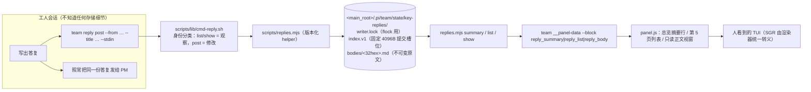

# P234 · pulse-key-replies apply（发布路径 + 存储 + 面板第五页）

task: P234 ｜ agent: dev2（任务书头写 `agent: dev`，派单到 dev2；报告路径按派单提示用 `P234-dev2.md`，与 `P232-dev2.md` 同例）
change: pulse-key-replies ｜ phase: apply ｜ branch: `task/P234-pulse-key-replies-apply`（本地模式，未推送）
tip: 返修轮次 1 后的新 tip `284d6f9`（首轮候选 `c84ca39`，V27 判 FAIL）｜ 日期: 2026-10-13 ｜ 门禁范围: 本 change 的 61/62 段 + tasks.md §6 点名的全部前门 + V27 的三条必修

候选之后只有**记录类**提交（本报告的 class-A 引用行、`openspec/changes/pulse-key-replies/tasks.md` 的勾选），没有产品字节改动；行为证据一律对应候选 `c84ca39`。

## 1. 结论

`openspec/changes/pulse-key-replies/` 的 **A（存储与 CLI）、B（面板第五页）、C 中属于本任务的两项（help 文本、门禁段落登记）** 已实现并逐条自测：

- 存储与只读面：`team reply post/list/show` + `scripts/replies.mjs`，固定 4096 字节提交槽位、不可变原文、OS fd 锁、durable/unconfirmed 两级回执、安全的部分尾部恢复、按算术定位的 list/show（每页最多 50 槽，不枚举正文目录）。
- 面板：第 5 页（列表 + 只读正文视窗）、总览的最新回复入口、三个 console-only 有界块（summary/list/body）与「按需求、按请求键」的调度；机器出口（`--print/--json/monitor`）逐字节不受影响。
- 本 change 的两个门禁段 61/62 已登记并全绿；tasks.md §6 点名的既有前门全部跑过（结果见 §4，红项已在 §8 逐条归因）。
- 两个与本任务相邻的产品缺陷在实现中被发现并修掉（`defaultPage` 记忆循环停在四页；一次性出口在非阻塞管道上丢帧尾），都有「坏源码→红→还原→绿」的翻转证据（§7）。

未做项只有一项，且有明确理由：tasks.md §4.1 的「更新 SKILL/协议的主动关键答复示例」——任务书边界明写 **不要碰 `SKILL.md`/`references/**`（属 routing S3）**，按 §1.3 它属于 C 阶段的另一个 owner。见 §9。

## 2. 交付物与模块边界

5 个提交（全部 Conventional Commits + `P234` + `Agent: dev2` trailer）：

| 提交 | 内容 |
|---|---|
| `8c41202` | `feat(replies)`：存储 helper + `team reply` 命令面 |
| `1687732` | `feat(panel)`：第 5 页、总览摘要、按需求读的三个块 |
| `f3f8a4f` | `test(replies)`：两组聚焦夹具（存储 11 组 / 面板 13 组） |
| `b6bf3f7` | `fix(panel)`：五页记忆循环 + 写全帧（§7 的两个翻转证据） |
| `323565e`、`f6952b1`、`b74104f` | `test(replies)`：夹具拆成 ui/pty 两个入口 + 隔离守卫 + 快照完整性 + 并发断言的确定性修正 |



边界纪律：产品面只碰 `scripts/replies.mjs`、`scripts/lib/cmd-reply.sh`、`cmd-watch.sh` 的块分发、`cmd-project.sh` 的 help、`common.sh` 的身份分类、`panel/**` 与 bundle、门禁登记（`smoke.sh` 的 61/62 段、`section-paths.tsv`、`section-budgets.tsv`）。**没有**碰 `templates/**`、`references/**`、`SKILL.md`、canonical specs，没有新建绕过门禁的独立套件，正文只落仓外账本面（`docs/team/` 下没有新增文件）。

## 3. tasks.md 逐条对照

| 条目 | 状态 | 落点 / 证据 |
|---|---|---|
| 1.1–1.3 PM 的输入冻结与串行移交 | 不属本任务 | 派单已按 P232 合并后的 tip 开工 |
| 2.1 分发/身份分类 + 版本化 helper + 输入上界 + 安全 project-state 定位；`--select input,paths`，未知组报错 | 完成 | `cmd-reply.sh`（`reply` 在 `common.sh` 里按「观察/修改」分类）、`replies.mjs`（`openStateDir` 逐段锚定，`relative` 检查不许逃出 main_root）、`key-replies.sh --select input,paths`；未知组 → rc2（`key-replies.sh: 未知测试组`）|
| 2.2 不可变原文 + checked fixed-slot 索引 + 稳定 no + OS fd 锁 + durable/unconfirmed + 安全尾部恢复；`original,concurrency,receipts,interrupt`；精确故障注入落点 | 完成 | `bodies/<32hex>.md`（独占创建→fsync→无覆盖 link→fsync 目录）、槽位 = `uint32 len + JSON + 零填充 + sha256(前 4064B)`、`flock`（锁挂在父进程持有的 fd 3 上）、`TEAM_REPLY_FAULT=kill:/fail:<point>` 十个落点；四组夹具 |
| 2.3 latest / cursor list / number show / raw 非 TTY 导出；`paging,bounded,readonly`；导出逐槽/逐正文 IO trace；不 mkdir、不全扫、坏页仍可继续 | 完成 | `summary`（只读最后一个整槽）、`list --before`（每页 ≤50 槽）、`show --raw`（TTY 上拒绝）、`LD_PRELOAD` IO 计数（10 万槽页与 60 槽页读入字节完全相同）、只读面用 `O_PATH` 目录句柄（无读权限 → 结构上不可能枚举）|
| 2.4 fixture-only 反例 `--select flip`：七个具名 guard 判红→还原判绿 | 完成 | 8 条臂（多一条「不枚举」），每条用独立 scratch 源码副本 + 具名探针 + 哈希对照（§7.1）|
| 3.1 PageId/偏好/页文件/main snapshot 扩到 5；总览 metadata 入口 + paged stable-number focus；`pty --select pages,overview,list,compose`；保留原 panel-b3 断言 | 完成 | `types.ts/settings.ts/data.ts/App.tsx/layout.ts` + `strings/{zh,en}.ts`；`defaultPage=5` 的循环也一并修（§7.2）；pty 四组 + panel-b3 全组（§4）|
| 3.2 正文状态 + 只读 markdown 视窗 + 完整滚动 + 返回；`pty --select body,mouse,resize` | 完成 | 复用既有 `renderAnsi`/详情滚动与返回路由；128 KiB 正文的尾标记经 End/PgUp/PgDn 可达；真实 SGR 鼠标首点聚焦、再点打开、Back 返回；resize 后仍在同一号正文 |
| 3.3 三个 console-only 有界块 + wanted gating + 请求键（cursor/number）取消 + 超时与输出上限；scan warm 前路由；`ui --select blocks,machine` + `pty --select async` | 完成 | `data.ts` 的 `BLOCK_SPECS`/`wantedSet`/`requestKey`/`blockChildren`（换键即杀旧子进程、丢弃晚到的响应）；三个块直接进 helper、不参与 `team_scan_warm`；`ui` 的 blocks/machine 组 + `pty` 的 async 组 |
| 3.4 zh/en + 窄屏短标签 + 全部新点击目标 + 安全显示；`ui --select snapshots,routing-regression`、pty `language` 组；四档宽度×两主题×双语 | 完成 | 新增 19 个字符串键（两侧键集相等）；页签短标签；`ui` 的 snapshots（4 宽×2 主题×2 语言×多状态）+ routing-regression（panel-p21/choices/strings/contrast 原样保留）；pty 的 language 组 |
| 3.5 同源 typecheck/build、逐帧审查快照差异后 `--update` 再复跑；记录 bundle 哈希与 tip | 完成 | typecheck 的 4 条错与 main 逐条相同（class A，§8）；`build.sh` 重复执行逐字节一致；bundle sha256 `d33c1f27…`（974586 B）；快照差异先逐帧看过（总览新增一行摘要、页签带第 5 页、第 5 页新档）再重钉 |
| 4.1 help/协议示例 + `workflow` 组 | 完成（PM 授权扩边界后补齐） | help（`cmd-project.sh`）· `SKILL.md` 的命令表一行 + 「不可协商规则」一条 · `references/protocol.md` 新增 §4b（含命令示例、五种结果的语义、receipt 的边界、存储位置与诚实限制）· `key-replies.sh --select workflow`（✓11 ✗0，五种结果后仍输出同一正文、账本哈希不变） |
| 4.2 登记到 smoke/section-select 的 owning section；既有投影/引用/隐私/diff/routing 前门分别出结果 | 完成 | 61/62 段 + `section-paths.tsv` + `section-budgets.tsv`；`spec-refs.sh --check`、`ledger-ban.sh`、`git diff --check`、`task-model-routing.sh`（§4）|
| 5.x、6 里的全量 smoke/perf | 不属本任务 | 见 §4 末尾与 §10 的复验指引 |

## 4. 验收命令与结果 · 轮次 0（首轮交付；返修后的复跑见 §11）

| 命令 | rc | 结果 |
|---|---|---|
| `bun openspec validate --all --strict` | 0 | `Totals: 16 passed, 0 failed`，含 `✓ change/pulse-key-replies` |
| `bash skills/teamsmith/tests/section-select.sh --paths <本任务路径>` | 0 | `decision=RUN keys=35`；`--check` → `ok 7 bad 0 SKIP 1` |
| `bash skills/teamsmith/tests/ledger-ban.sh --names-file <main>/.pi/team/forbidden-names.txt` | 0 | `files=1367 hits=0 names=ok user=resolved` |
| `git diff --check && git status --short` | 0 | 无输出（树干净） |
| `bash skills/teamsmith/tests/key-replies.sh --all` | 0 | **✓168 ✗0**（11 组；input/paths/original/concurrency/receipts/interrupt/paging/bounded/readonly/workflow/flip） |
| `bash skills/teamsmith/tests/key-replies-ui.sh --all` | 0 | **✓85 ✗0**（blocks/machine/snapshots/routing-regression） |
| `bash skills/teamsmith/tests/key-replies-pty.sh --all` | 0 | **✓80 ✗0**（pages/overview/list/body/mouse/resize/language/async/compose） |
| `bash skills/teamsmith/tests/panel-b3.sh`（全部场景） | 1 | ✓176 ✗8：8 条全是 main 上同样存在的「已放弃」车道红（base 对照 ✓147 ✗8，同数同文本） |
| `bash skills/teamsmith/tests/panel-p21.sh` | 1 | ✓323 ✗8：8 条是 `team config upgrade-models` 遗留迁移组（属未落地的 task-model-routing；base ✓322 ✗8） |
| `bash skills/teamsmith/tests/panel-choices.sh` | 0 | ✓48 ✗0 |
| `node skills/teamsmith/tests/panel-strings.mjs` | 0 | `ok`（383 键 / 116 schema 键 / 12 group token，双向） |
| `node skills/teamsmith/tests/panel-contrast.mjs` | 0 | `ok (every declared pair ≥ 4.5:1)` |
| `bash skills/teamsmith/tests/panel-snapshots.sh`（无 `--update`） | 0 | ✓52 ✗0 |
| `bash skills/teamsmith/tests/task-model-routing.sh` | 0 | `RESULT pass=2962 fail=0` |
| `(cd skills/teamsmith/scripts/panel && bun run typecheck)` | 2 | 4 条 TS 错，与 main 逐条相同（`OutboxListBlock.impediments/impeded`）→ class A |
| `(cd skills/teamsmith/scripts/panel && bash build.sh)` | 0 | `panel.js 974586 B sha256 d33c1f27…`；重复 build 逐字节一致 |
| `bash skills/teamsmith/tests/key-replies.sh --select workflow`（§4.1 补齐后复跑） | 0 | ✓11 ✗0（fixture Agent 在 saved/invalid/unavailable/busy/unconfirmed 后仍输出同一正文，账本哈希不变） |
| `bash skills/teamsmith/tests/section-select.sh --paths skills/teamsmith/SKILL.md skills/teamsmith/references/protocol.md` | 0 | `decision=RUN keys=30`（新加的文档面落在应跑的段里） |
| `bash skills/teamsmith/tests/smoke.sh --select 18,14b` | 0 | ✓83 ✗0 —— 18 段的英文正文不变量（新加的两处英文段落无 CJK）与 14b 的「已删命令不得回潮」都照旧绿；`0b`（skill 可被解析器加载）也随段跑到 |
| `TEAM_SMOKE_NO_LOCK=1 bash skills/teamsmith/tests/smoke.sh --select 61,62` | 见 §4 末注 | **61 段 ✓1 ✗0（段内 168 断言）· 62 段 ✓2 ✗0（段内 85+80 断言）**；整轮另有 26 段的 2 条 class-A 红（§8）。用 `TEAM_SMOKE_NO_LOCK=1` 绕过了 gate 排队（当时另一席位的全量 smoke 持锁），此点在此明示 |

段内断言计数（同一批夹具在选段里跑的）：61 段 168 条、62 段 165 条（ui 快组 85 + pty 80）。

**关于 gate 运行有效性**：第一次选段（10:31–10:45）在跑动中我写了本报告文件，触发运行指纹不一致、退出码 4（该轮 ✓/✗ 按门禁规则作废，虽然 61/62 两段本身是 ✓1/✓2 ✗0）。此后树不再变动、重跑同一选段：

```
#11 61 · 关键回复存储与 CLI（change: pulse-key-replies · P234） · 用时 76s · ✓1 ✗0 SKIP0
#12 62 · 关键回复面板第 5 页（change: pulse-key-replies · P234） · 用时 297s · ✓2 ✗0 SKIP0
账本自查： 12 段收口 · 增量 ✓415 ✗2 SKIP0 ｜ 结果行 ✓415 ✗2 —— 一致
== 选段结果 ==  ✓ 415  ✗ 2        （退出码 1：两条红即 §8 的 26 段 class A；不是 4，树在跑动中未变）
```

因此本 change 的两个门禁段在有效运行里都是绿的。

证据包（D94：仓外）：`/tmp/p234-evidence`（pty：帧/argv/日志 18 件）、`/tmp/p234-evidence-ui`（ui：快照/机器出口/前门日志 10 件），共 28 件，由 `TEAM_REPLY_EVIDENCE` 导出。

## 5. 关键设计决策与取舍

**存储**：固定 4096 字节槽位、前 4064 字节是 `uint32 长度 + JSON + 零填充`、末 32 字节是前 4064 字节的 SHA-256。选择固定槽位的理由是 `no = 偏移 / 4096 + 1` —— show 用一次算术定位、list 每页只读 50 个槽，**不存在**任何「读到哪算到哪」的解析状态；代价是元数据有 4 KiB 的硬上界（标题 160 码点、正文另存），超过就拒绝而不是截断。

**提交点**：原文先独占创建、fsync、无覆盖 `link` 进 `bodies/`、fsync 目录；然后写完整槽位并 fsync 索引。可见性在索引 fsync 之后。最终 fsync 失败时输出 `outcome=unconfirmed` + `candidate_no` 并 rc6 —— 条目可能已可见，所以既不能宣告成功也不能自动重发。明确不足 4096 字节的尾巴在下次写时截到槽边界；**完整**的坏槽则拒绝写入并报 rc4，绝不当作「未提交的尾巴」抹掉。

**锁**：`flock` 挂在父进程持有的 fd 3 上（子进程用 `stdio[3]` 拿到同一个 open-file description），锁在本进程退出/被杀时由内核释放；等待上界 2000 ms，超时 rc5。读者完全不参与锁。

**只读面**：绝不 mkdir、绝不写盘、绝不等锁；缺 store 是显式空结果（rc0），坏 store 是不可用（rc4）。`bodies/` 用 `O_PATH` 目录句柄打开 —— 它没有读权限、不能 `getdents`，所以「枚举正文目录」在结构上就不可能（夹具用 `chmod 0111` 把这条钉死，并有一条 flip 臂在变异后判红）。

**面板**：第 5 页复用既有的块装配与渲染器；列表/正文是两个**按需求**的块（`wantedSet` + `requestKey`），换 cursor/号数即杀掉在飞的旧子进程并丢弃晚到的响应 —— 「晚到的页或正文绝不覆盖用户正在看的选择」。正文只以「安全显示文本」进 TUI（`sanitize` 剥 OSC/CSI/C1/ESC 与不可见格式控制），原文只在存储里。

**取舍**：不为 key replies 引入任何配置键、待办/提醒状态、Pi 工具或扩展；发布失败不阻断答复（正文照常输出，诊断只进 stderr）。

## 6. 真 tmux 取证（面板）

`key-replies-pty.sh` 用私有 socket 的真 tmux + 真按键（`send-keys` 与 pty 直驱两路），逐帧断言：

- 第 5 页列表（60 槽）：首帧 `#60`，`←` 到最旧页 `#10…#1`，再 `←` 不前进不空帧，`↓`×12 把焦点夹在 `#1`，Enter 打开 `#1` 全文，`q` 回到同一页同一焦点，`→` 回上一页，`r` 回最新页。
- 正文视窗：打开时停在文首（尾标记不可见）→ End 到底 `END-MARKER-P234` 可达 → PgUp 离开 → PgDn 回来；`q`/Esc 还原 context。
- 失败可见但不阻断：坏槽页仍给出可用行与「Older」route；坏正文给「这份回复不可用」而不是空转；PM 的 compose 草稿在发布尝试后逐字节不变且 argv 里没有 `post`。
- 鼠标：首点聚焦、再点打开、Back 芯片返回（驱动器从真实 capture 里定位目标行，SGR 坐标注入）；滚轮走直驱 pty（tmux 会吃滚轮事件，既有测量）并断言变更块里不再出现最新行、滚到底被夹住。
- 语言/尺寸：59/99/120/160 列 × zh/en 的页签、导航与正文均可达。
- 慢读者：把 summary/list 各自延迟 5 s，输入时钟不被冻结（帧仍在刷新）、晚到的响应不覆盖新选择。

原始帧与 argv 台账在证据包（`pty-list-oldest.txt`、`pty-body-end.txt`、`pty-mouse-open.txt`、`pty-async-argv.log` 等）。

## 7. 红侧证据（坏源码→红→还原→绿）

### 7.1 存储的八条具名 guard（`key-replies.sh --select flip`）

每条臂都用**独立 scratch 源码副本**改坏、跑具名探针、再换回干净副本按哈希确认，然后判绿：

| 臂 | 改坏什么 | 判红的 guard |
|---|---|---|
| `no-lock` | 去掉 `flock` 取锁 | 锁竞争必须 rc5 |
| `early-saved` | 让 unconfirmed 分支不可达 | 最终 fsync 失败必须 rc6 且不冒充 saved |
| `raw-tail` | `--raw` 少写最后一个字节 | 原文逐字节相等 |
| `no-cursor` | `next_before` 恒为 null | 第二页必须可达 |
| `full-scan` | 一页读全部槽位 | 一页读入字节 ≤ 51×4096（IO 计数） |
| `symlink` | 去掉 `O_NOFOLLOW` | 索引是软链必须 rc4 且外根文件不被读 |
| `readonly-mkdir` | 读路径也 mkdir | 缺 store 读后仍缺 |
| `no-enumerate` | 正文目录改用可读句柄 | `bodies/` 不可枚举时读命令仍成功 |
| `fifo_block` | 读路径去掉 `O_NONBLOCK`（V27 M1 的翻转臂） | 对 FIFO 索引的读命令必须不挂住（rc≠124） |

每臂输出形如 `flip/<臂>：变异后 guard 判红 → 还原哈希一致后判绿（matched=1）`，并在证据包里留 mutation/restore 的哈希与两次探针 rc。

brief 点名要求的三条红侧也都在：

- 索引越界：`concurrency：编号耗尽被诊断为不可用（不环绕）`（`nextNumber` 是唯一分配点）+ `interrupt：完整坏槽时 post 拒绝（rc4）而不是截断`。
- 原文被改写：`original：正文被改写（哈希不符）→ rc4`、`original：正文非法 UTF-8 → rc4`、`original：坏正文不输出部分内容`。
- 提交失败仍宣告成功：`receipts：最终 fsync 失败 → rc6` + `not_has '"outcome":"saved"'` + `early-saved` 臂。

### 7.2 一次性出口的半截帧（确定性探针）

实现过程中发现：`--snapshot/--print/--json` 用**一次** `writeSync` 写整帧，而 Node 把管道上的 fd 1 设为非阻塞 —— 单次写可能只写进去一部分。实测：160 列的第 5 页快照经 `sed` 管道平均每 5 次丢 1 次帧尾（丢 462 字节、切在多字节字符中间）。

红侧是**确定性**的：把 4 KiB 的管道配一个慢读者，5 KB 以上的帧必然短写。夹具因此有两层守卫：每个快照必须是完整 UTF-8 且以换行结尾；以及一条 4 KiB 管道探针（`probe == 文件参考字节数`）。

| 树 | 结果 |
|---|---|
| 变异体（还原成修复前的 `out()`，重建 scratch bundle） | **✗3**：`snapshots：160×dark×en 是半截帧（TRUNCATED … position 4584）`、`有半截帧（4 个文件）`、`管道上丢了尾巴（probe=TRUNCATED-mid-character 参考=8888）` |
| 交付树（`out()` 写全帧，含 EAGAIN 等待） | ✓61 ✗0，管道探针 `8888 字节 = 文件参考字节数` |

`defaultPage` 的五页循环同属「坏源码→红→绿」：修前 `panel-b3` 的 `defaultPage` 四条断言全红（循环停在 4，第 5 页永远记不住、下次启动被当越界重置），修后四条全绿（`defaultPage 循环到 5（五页 + 回绕）`）。

## 8. 与本任务无关的红（独立对比归因）

| 红 | 归因 | 证据 |
|---|---|---|
| `panel-b3` 8 条「已放弃」车道红 | main 上同样存在 | 在 main 的干净副本上跑同一场景：✓147 ✗8，同数同文本 |
| `panel-p21` 8 条 `team config upgrade-models` 红 | 属未落地的 task-model-routing change | main 副本 ✓322 ✗8，同数同文本；本任务未碰 config/模型路由 |
| `bun run typecheck` 4 条 TS 错 | main 上逐条相同 | 两棵树的错误集合一致（`OutboxListBlock.impediments/impeded`） |
| smoke 26 段 2 条（`session_tokens 非空`、`elapsed 保留在 JSON 里`） | 已在独立复验里归为 class A（A8） | `docs/team/reports/V25-verify.md`：**A8 条目标题在第 106 行**（`### A8 · 面板会话大小按 committed assignment 关联（2 条，已复现确认）`），**点名这两条红的第 108 行**（`- 段：§26 26-g session_tokens 非空、elapsed 保留在 JSON 里。`），**红项台账的第 345、346 行**是编号 89、90 两行（`\| 26 \| 26-g agent 表：session_tokens 非空（真实会话文件）（python: ） \| A \| A8 \|` 与 `\| 26 \| 26-g agent 表：elapsed 保留在 JSON 里 \| A \| A8 \|`）|

`routing-regression` 组因此不要求 `panel-p21` 整体 rc=0，而是「除已知的迁移诊断红之外一条新红都没有 + 绿数不低于基线 322」——这正是「第五页不许用删除旧断言换取」的写法。

## 9. 未做项与交给 PM 的判断

1. ~~tasks.md §4.1 的 SKILL/协议示例~~ **已补齐（PM 在复验期间授权扩边界）**：任务书原本把 `SKILL.md`/`references/**` 划为 routing S3 的写集合，PM 于 2026-10-13 11:24Z 明确指示「在同一分支上把剩下的部分补完，只加文档/示例、不要改产品代码」，因此本任务补上了：

   - `skills/teamsmith/SKILL.md`：命令表新增「Key replies」一行（`post`/`list`/`show` 的用法与 receipt 语义，指向 §4b）；「Non-negotiable rules」新增一条 **Publish the body before you answer**（发布失败不改变你要发的内容、诊断只进 stderr、saved 只表示项目内持久化）。
   - `skills/teamsmith/references/protocol.md`：新增 **§4b Key replies: publish the body before you answer** —— 为什么需要（wake-up 的指针与报告的流程都不携带正文）、`post` 的调用示例、五种结果的语义（0/2/4/5/6，锁等待有界、unconfirmed 绝不自动重发）、receipt 的边界（非投递/审批/已读/刷新，不产生待办与唤醒，不新增配置键）、存储位置（`<main_root>/.pi/team/state/key-replies/`，在发布面之外）、读回方式（list/show/`--raw`/控制台第 5 页）与**诚实限制**（夹具只能证明 fixture Agent 两个出口同文，真实 Agent 是否遵守无法由工具验证）。

   两文件都在 `skills/teamsmith/**` 的产品文档面，按 `references/protocol.md` §4b 的口径属「文档类追加」，无产品代码/字节改动；复验的候选 `c84ca39` 保持有效，PM 会重新冻结并把新增文档通知复验者。
2. **全量 smoke 与 perf**：按 tasks.md §5.2/§6，它们属于最终稳定树上的交付/复验步骤（后台跑、并记录负载前提）。本轮只跑了本 change 的 61/62 段与它们依赖的既有段。
3. **报告文件名**：任务书模板写 `P234-dev.md`，派单与席位是 dev2（同 `P232-dev2.md` 之例），本报告用 `P234-dev2.md`；若 PM 要按模板归档，重命名即可。
4. **gate 排队**：本轮最后一次选段用了 `TEAM_SMOKE_NO_LOCK=1`（当时另一席位的全量 smoke 持锁，排队上限 1800 s 会让短选段白等）。若 PM 要求严格的排队记录，复验时去掉该环境变量即可。

## 10. 复验指引

```bash
# 1) 存储与 CLI（含 8 条翻转臂），约 100 s
bash skills/teamsmith/tests/key-replies.sh --all
# 2) 面板读数面（含既有前门），约 17 min
bash skills/teamsmith/tests/key-replies-ui.sh --all
# 3) 面板真 pty（私有 tmux），约 5 min
bash skills/teamsmith/tests/key-replies-pty.sh --all
# 4) 本 change 的两个门禁段（会连带跑 0/2/18/26/27/28/38 段）
bash skills/teamsmith/tests/smoke.sh --select 61,62
# 5) 既有前门
bash skills/teamsmith/tests/panel-b3.sh && bash skills/teamsmith/tests/panel-p21.sh \
  && bash skills/teamsmith/tests/panel-choices.sh && node skills/teamsmith/tests/panel-strings.mjs \
  && node skills/teamsmith/tests/panel-contrast.mjs && bash skills/teamsmith/tests/panel-snapshots.sh
# 6) 结构面
"$HOME/.bun/bin/bun" "$HOME/.bun/bin/openspec" validate --all --strict
bash skills/teamsmith/tests/spec-refs.sh --check
bash skills/teamsmith/tests/ledger-ban.sh --names-file "$CONTROL_ROOT/.pi/team/forbidden-names.txt"
git diff --check
```

复验时请特别看两处：`key-replies.sh --select flip`（红→绿两态是否都在）与 `key-replies-ui.sh --select snapshots` 的「4 KiB 管道」那条（它用变异体测过会红）。所有夹具都会在开写前断言 `team paths` 的 main_root 等于夹具仓库，并在结束时断言真实仓库的 `docs/team/inbox` 与 `.pi/team/state` 逐字节不变。

## 11. 返修轮次 1（V27 判 FAIL 后的三条必修）

受检 tip `a0107a0` 的复验记录 `docs/team/reviews/V27.md` 判 FAIL，实体是三条；本节逐条给根因、修法与**红侧**。返修后的续验是 **V27 的第二轮**（同一复验任务、换会话/席位；PM 2026-10-13 13:17Z 更正，不是新任务），交付 tip 为 `b6f5f33`。

### 11.1 M1 · 非正规 index/body 让读命令永久挂住

- 根因：读路径的索引 fd 与 `readBody()` 只用 `O_RDONLY|O_NOFOLLOW` 打开，**没有** `O_NONBLOCK`；
  `open(2)` 一个 FIFO 会一直等到有写者，于是 `reply list`/`show`（含 `--raw`）永久挂住（V27 实测 rc 124）。
- 修法：`openFileAt()` 统一带上 `O_NONBLOCK`（正规文件的 read/write 不受它影响，所以没有「检查后清位」
  这一步；Node 也没有 fcntl 绑定），FIFO 立刻打开成功、紧接着的 `fstat().isFile()` 判定把它拒掉。
- 红侧（两条独立证据）：
  1. **修复前的 CLI × 新的守卫**：把 `01cf848^` 的 `replies.mjs` + `cmd-reply.sh` 放进 scratch 源码树后跑
     `key-replies.sh --select paths,paging` → **✓42 ✗8**，其中 6 条正是
     `paths：index 是 FIFO 时 list 永久挂住（rc 124）`、`show 永久挂住`、`正文是 FIFO 时 show/--raw 永久挂住`
     与两条「诊断里没有 `not a regular file`」；同一守卫在当前树上 **✓50 ✗0**。
  2. **`flip/fifo_block` 臂**（第九条具名 guard）：独立 scratch 源码把 `O_NONBLOCK` 从读路径删掉 →
     该臂判红（对 FIFO 索引 rc 124）→ 还原哈希一致后判绿。
- 夹具现在钉住：`index`/`body`（含 `--raw`）是 FIFO 时 `rc=4` + 诊断含 `not a regular file`，全程用
  `timeout 4` 包裹（挂住即 rc 124 → 判红），并且「正文是 FIFO 不影响 list」（list 不读正文）。

### 11.2 M2 · `--before … --json` 静默丢游标

- 根因：`scripts/lib/cmd-reply.sh` 的 list 分支里 `--json) extra=(--format json) ;;` 是**赋值**，
  把先前解析到的 `--before` 整个覆盖掉 → 静默返回最新页。
- 修法：改为 `extra+=(--format json)`（并在注释里写明为什么不能是赋值）。
- 红侧：修复前的 CLI 跑同一组夹具 → `paging：--before 31 --json 生效（顺序无关）` 期望 30 实际 **123**、
  `--before=31 --json` 同样 123；当前树上两条都 30。三种写法（`--json --before 31`、`--before 31 --json`、
  `--before=31 --json`）与文本形态（helper `--format text`）全部钉住。

### 11.3 M3 · 门禁镜像里没有编译器，导致登记的段在门禁环境里红

**决定：走路线 ①（换掉依赖编译器的手段），并把路线 ② 的纪律用在「观测器不可用」这一残余情形上。**

依据：

1. `ci/Containerfile` 按 M47 的约定在编译完 tmux 后 `apt-get purge build-essential …`，**故意**让镜像里
   永远没有编译器；`.github/workflows/gates.yml` 用的就是这份镜像。因此任何依赖编译器的手段在本仓库的
   门禁环境里都是**永久红**，不是可修的偶发。
2. 换成内核自述的接口即可，宿主与容器一致可用：`/proc/<pid>/io` 的 `rchar`/`syscr`（读类系统调用的字节数
   与次数）与 `/proc/<pid>/fd{,info}`（进程真正打开过哪些路径、以什么 flags 打开）。实现落在
   `tests/lib/proc-io.sh`（两套夹具共用）。
3. 断言形式改成**差分**（10 万槽 store 与 60 槽 store 各取一页后相减），把进程基线消掉：
   实测 Δrchar = −44…−93 字节（噪声级），而全扫一次是 412,001,218 字节 —— 七个数量级的余量；
   Δsyscr = 0。
4. 不依赖任何计数器的**结构性/行为化**证据同时钉住同一件事：`bodies/` 目录以 `O_PATH` 打开
   （fdinfo 实测 `flags=012600000`）→ 内核层面不可能 `getdents`；把一份正文 `chmod 0000` 后
   `show` 必 rc4 且诊断点名 `EACCES`，而 `list`/`summary` 照常 rc0 —— 「谁真的读了正文」由此成为
   确定性行为差异，不靠采样。
5. 观测器不可用时（hidepid、非 Linux 等）**可见跳过并点名**，绝不静默通过：`bounded` 的两条读取量断言与
   `flip/full_scan` 都打印 `SKIP` 并点名 `/proc/<pid>/io`；新增 `skip-path` 组用
   `TEAM_REPLY_NO_PROC_IO=1` 端到端证明这条路径（子进程跑完整轮、✗0、3 条具名跳过、没有任何红）。
6. `ci/Containerfile` **未改动**（无需单独提交）。

容器内（钉死镜像 `localhost/teamsmith-gate:local`，干净 clone 只读挂载）复现与修复后对照：

| 命令 | V27 记录的容器结果 | 本轮容器结果 |
|---|---|---|
| `key-replies.sh --select bounded` | ✓4 ✗1（shim 编不出来） | 见下表（整段 ✓187 ✗0） |
| `key-replies.sh --select flip` | ✓8 ✗1（同一 shim 的连带） | 同上 |
| `smoke.sh --select 61` | ✓21 ✗1 | **✓22 ✗0**（`#5 · 61` ✓1 ✗0） |

### 11.4 返修轮次的验收（宿主与容器各一次）

宿主（本工作树，最终树 `284d6f9`，工作树干净）：

| 命令 | rc | 结果 |
|---|---|---|
| `bash skills/teamsmith/tests/key-replies.sh --all` | 0 | **✓187 ✗0**（十二组；用时 1m42s） |
| `bash skills/teamsmith/tests/key-replies-ui.sh --all` | 0 | **✓85 ✗0** |
| `bash skills/teamsmith/tests/key-replies-pty.sh --all` | 0 | **✓80 ✗0** |
| `bash skills/teamsmith/tests/smoke.sh --select 61` | 0 | **✓22 ✗0**（`#5 · 61` ✓1 ✗0，用时 101s） |

容器（`localhost/teamsmith-gate:local`，`/tmp/p234-c1` 干净 clone 只读挂载，`HOME=/tmp`，
前缀 `git config --global --add safe.directory '*'` —— 与 CI 的调用一致；**缺这个前缀时 `#4 0d` 冲突标记守卫
会因容器内 git 的 dubious-ownership 报「找不到受检的 git 工作树」而红**，那是调用方式的环境差异、与本 change
无关，第一次容器 smoke 就是这样拿到 ✓21 ✗1 的，加上前缀后 ✓22 ✗0）：

| 命令 | rc | 结果 |
|---|---|---|
| `key-replies.sh --all` | 0 | **✓187 ✗0** |
| `key-replies-ui.sh --all` | 0 | **✓85 ✗0** |
| `key-replies-pty.sh --all` | 0 | **✓80 ✗0** |
| `smoke.sh --select 61` | 0 | **✓22 ✗0**（`#5 · 61` ✓1 ✗0，用时 93s） |

结构面（宿主）：`openspec validate --all --strict` 16/0 · `spec-refs.sh --check` retired 0 / undeclared 0 ·
`ledger-ban.sh` files=1368 hits=0 · `section-select.sh --check` ok 7 bad 0 SKIP 1 ·
`section-select.sh --paths <本任务路径>` RUN keys=30 · `git diff --check` 干净 · 树干净。

**一次负载下的偶发（如实记录）**：在同时跑三件重活（本夹具 + 另一席位的全量 smoke + 容器镜像）时，
`skip-path` 的子进程曾以 rc=1 结束、而它的日志里没有任何红行（老写法只断言 rc，无从判断成因）。
断言已改成「子进程末行是结果行且 ✗0」并在失败时**带 trace 重跑一次取证**（红照旧判红），此后在本机
重跑 6 次（含负载期）全绿。V27 的第二轮（同一复验任务、换会话/席位；PM 于 2026-10-13 13:17Z 更正：不是新任务 V29）若再遇到，断言消息里会直接给出子进程的结果行、红行与 trace 路径。

### 11.5 未动的东西

- `ci/Containerfile`、`.github/workflows/**`：未改。
- 产品代码：只改了 `scripts/replies.mjs`（一处 `O_NONBLOCK`）与 `scripts/lib/cmd-reply.sh`（一处 `+=`）；
  bundle 未重建（面板源码未动，`panel.js` 与候选逐字节相同）。
- 既有前门：本轮未重跑 `panel-b3`/`panel-p21`/`panel-choices`/`panel-strings`/`panel-contrast`/
  `panel-snapshots`/`task-model-routing`（面板源码零改动；它们的轮次 0 结果与归因仍有效），
  61/62 两段依赖的既有段由 `smoke --select 61` 连带跑到（0/0b/0c/0d 全绿）。
