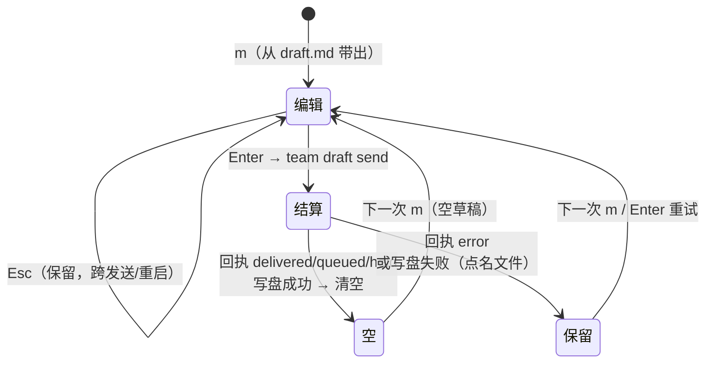

# panel-preview-and-compose · 设计

本文件只写提案阶段的取舍与合同归属；实现细节（具体函数名、行号）留给 apply 席位。规格文本一律以
`specs/panel/spec.md` 的 delta 为准，本文件不复制它。

## 1 目标与不变量

- 目标一：把**写信槽的草稿生命周期**写成可证伪的合同（用户诉求 ①）。
- 目标二：在**既有详情视图**上开三个只读预览面：规格、变更、决策（用户诉求 ②③）。
- 不变量（三条贯穿全程）：预览不引入第二条文件读取/渲染路径；预览不引入任何写操作；机器出口
  （`team monitor --print`/`--json`）的字节与键集不变。

## 2 草稿生命周期：结算规则

回执类由既有 `mapReceipt` 决定，判决表就是 `(rc, outcome, result)` 到「输入行 + `state/draft.md`」的映射：

| 机器结果 | 回执类 | 帧上的话 | 草稿 | 判据 |
|---|---|---|---|---|
| rc=0，`delivered`/`forced`/`unknown-sent`/`duplicate` | `delivered` | ✓ 已送达 | **清空** | 消息已出去 |
| rc=0，`queued`（含 `result=busy`） | `queued` | … 已入队（PM 框在忙） | **清空**（裁定点 D1） | 条目已 durable，回执告诉用户它在队列里 |
| rc=0，`result=held`/`terminal`（`unconfirmed`） | `held` | ! 滞留（副本在 outbox/held/） | **清空**（裁定点 D2） | 结算不是丢失；payload 可能已在 PM 框里，保留会诱发第二次粘贴 |
| rc≠0 且无 durable 结果（`offline`、`unknown-failed`、桥没跑、无机器行） | `error` | ✗ 投递未确认 | **保留** | 文字只存在于输入行 |
| rc≠0，`geometry-untrusted`/`queue-stalled`（交付守卫的既有语义：held + reason + 非零退出） | `error` | ✗ 投递未确认（带 reason） | **保留** | 一个字都没写进 PM 框，条目在 held/ |

判定表只依赖回执类，不解析人话。两个裁定点（D1/D2）的理由、反例与切换成本见 `proposal.md`；本文件按推荐版本
（清空）落笔。

结算的**原子性**：先写 `state/draft.md`，写成功才清内存；写失败（文件只读、目录只读）时**保持内存里的草稿**并在
回执里点名该文件。这样「内存 = 磁盘」这条不变量两边都成立，幽灵草稿（内存已空、磁盘还留着已发出的正文、下次 `m`
把它带回来）在构造上不可能出现。既有入口不受影响：Esc 仍跨「发送之间」保留草稿；输入行自己的删除键（`ctrl+u`/
`ctrl+k`、按码点退格）清空后持久化的是空草稿，后续回执与刷新都不会把它复活。

## 3 入口取舍：怎么到达这三个面

| 方案 | 内容 | 代价 | 结论 |
|---|---|---|---|
| A 第六页 | 新增顶层页（列表 + 详情） | 页导航合同（`1`–`6`、Tab 环绕、`panel-page` 值域、59 列下的页签可达性）连带改；还要一个新列表块与一套新焦点/翻页 | 否决：契约面最大、收益与「看已有三块的行」相同 |
| B 既有页里开详情（推荐） | 工作页三块的行加入该页的可聚焦集合，`enter`/点击打开同一个详情视图，带 source | 工作页焦点从「板内行走」推广为「整页绘制序行走」；一条既有场景（空看板无死项）与它的 pty 夹具要按新语义重述 | **采用**：不新增页面/列表/读取路径，复用已有的详情视图与行焦点机制 |
| C 从别处的引用跳过来 | 在正文里把 `openspec/changes/x`、`D123` 变成可跳目标 | 要给 markdown 渲染器加可点击引用解析（新机制），且仍需要一个落地入口 | 否决（本 change 不做）：它解决的是「来源」，不是「能读」；留作后续 |

方案 B 的覆盖面说明：面板能打开的是**三块真正画出的行**（变更块列全部活动变更；规格块列前 6 条；决策块列最近 3
条）。读取面本身接受任意合法 id（规格名、变更 id、`D<n>`），所以「按决策号定位」在读取面成立；**任意编号的键盘
输入**（一个「定位」提示行）不在本 change 里，设计上它只是在方案 B 之上加一个输入模式，不需要新页面。这条缺口写进
交付报告的「没做什么」，不在规格里承诺。

## 4 预览读取面：一个块，四种 source

`team __panel-data --block detail` 增加 `--source entry|spec|change|decision`（缺省 `entry` = 今天的语义，所有既有
调用与场景不变）。四类 source 的发现集：

| source | 发现集（相对项目根） | tab |
|---|---|---|
| `entry` | `docs/team/tasks/<ID>-*.md`、`docs/team/reports/<ID>-*.md`、`docs/team/reviews/<ID>.md`、`docs/team/reviews/<ID>-*.md` | 不变 |
| `spec` | `openspec/specs/<capability>/spec.md` | `spec` |
| `change` | `openspec/changes/<id>/{proposal,design,tasks}.md`（按此序，缺的不补） | `proposal`/`design`/`tasks` |
| `decision` | `docs/team/DECISIONS.md` 中该编号条目的正文切片 | 该编号（`D<n>`） |

要点：

- **根**：规格/变更走既有 `team_spec_dir_abs`（`TEAM_SPEC_DIR` 可覆盖），决策走账本固定文件；不新造根解析。
- **id 文法**：capability/change 用 `[A-Za-z0-9._-]`（既有的 detail id 文法），决策用 `D<digits>`；集合外的 source
  或文法外的 id 一律非零退出 + 一行点名、不打印正文。
- **拒绝集**：`--file` 必须命中**该 source 本次发现**出的路径（跨 source 的合法路径也拒绝）；发现出的路径若是软链
  → 拒绝并点名，不穿透。决策 source 不提供「整文件」出口：只服务所请求条目的切片，`--file` 只能选它那一个文件。
- **决策切片边界**：条目标题 = `##`/`###` 且 id 后跟非数字；正文到「同层或更浅的下一个标题」为止，同 id 的更深层
  补记（`### D7 补记`）留在正文里。查无此号 → 空文件表 + 可读的 unavailable 原因（不是错误帧，也不是邻居条目的
  正文）。
- **上界与消毒**：沿用 128 KiB 截断 + `truncated` 标记、`iconv -c` 收尾、消毒器；坏源/长正文只影响自己的块。
- **只读**：块只读文件；面板侧该块仍在视图打开时才被请求（`detail` 块的既有 wanted 规则），`--print`/`--json` 不
  装配它、不新增字段。

## 5 工作页的焦点与绘制序

- **焦点身份**：沿用现有的 `FocusRef`（`{lane, id, nth}`）——把 `lane` 当作「块作用域」用：看板行继续用车道名，
  预览行用块名（`specs`/`changes`/`decisions`）。这样 `resolveFocus`/点击目标/「焦点跨刷新留在同一行」的既有规则
  原样适用，不需要平行的第二套状态。
- **绘制序**：布局现在只在块真正画出自己的行时报告 `order`（降级成摘要行时不报告）。改成按**放置顺序**把各块的
  行序拼成一页一份的「页面行序」：先左列后右列（今天是板 → 变更 → 规格 → 决策），块内按绘制行序。首个 `↓` 落在
  绘制序的第一行（看板还在第一块，所以既有 pty 断言不变）；走到一块的最后一行之后跨到下一块的第一行。
- **source 派生**：行的 source 由它被画出的块决定（板 → `entry`；变更 → `change`；规格 → `spec`；决策 → `decision`），
  id 取该行的**键**（change id、capability 名、`D<n>`），绝不取显示标题。打开详情时把 `(source, id)` 交给同一个
  `setDetail` 路径，`esc`/`q` 仍回原页、不收缩控制台。
- **与看板页共享焦点**：工作页与看板页共用 `focusRef`（既有夹具钉住「焦点状态两页共用」）。预览行的 ref 落在
  看板页时匹配不到任何车道 → 看板不画光标，`←`/`→`/`↑`/`↓` 一走就换回板内 ref；不会出现两个光标。
- **空/降级块**：空块、摘要行降级、块缺席三种情况都不贡献行、光标与点击目标（既有语义，推广到三个预览块）。
- **鼠标与键带**：行上的 `focus` 目标与「先聚焦、再点击打开」的两段行为与看板行同一套；行聚焦时键带照旧发行键
  （`↑`/`↓` 行走、`enter` 打开），`pageUp`/`pageDown` 仍翻页。

## 6 显示面：i18n、宽度、主题、密度

预览视图就是既有详情视图（tab 行 + 文档窗口 + 键带），所以四档宽度、两种主题、两种密度、`state is never carried
by color alone` 与 zh/en 表的关系**继承**详情视图的既有条款，不新增显示规则。新增的可视文本只有两处：详情视图对
缺失 source/目标的 unavailable 文案，以及草稿清空失败时点名文件的那一行；两处都进 zh/en 两张表，字符串门的双向
断言照旧。tab 上的 token（`spec`/`proposal`/`design`/`tasks`/`D<n>`）是块给的数据 token，不是 UI 文案——与既有
`brief`/`report:dev2`/`review` 的处理一致。

## 7 验证策略与红侧

每条合同都点名红侧；verify 由**另一个席位**在独立现场跑。

| 合同 | 夹具 | 红侧（必须能变红） |
|---|---|---|
| 结算清空（内存 = 磁盘） | `panel-b2.sh` 新增结算组（delivered/queued 两次真 pty 发送 + 重启后 `m`） | 拿掉 `updateDraft('', false)`/`clearDraft` 的任一调用 → 该组红 |
| `error` 类保留文字 | 同一个组的失败回执支（桥非零退出无机器行 / `offline`） | 把判定改成「非空回执就清空」→ 红 |
| `held` 是结算 | 静态页脚夹具（`unconfirmed`） | 把 `held` 划进 `error` 类（不清空）→ 「settled send empties the box」变体红 |
| 写盘失败不假装清掉 | 发送后把 `state/draft.md` 置为只读 | 回到今天的「先清内存、写盘吞错」→ 红（输入行空、文件还在 = 幽灵草稿） |
| 预览 source 的发现集/顺序 | `smoke.sh` 详情读者段（夹具 spec/change/decision 树） | 删掉 source 判据（回落到 entry 发现）→ 红；凭空补一个不存在的 tab → 红 |
| 拒绝集（越界路径/跨 source/非法 id/软链） | 同上 | 放开 `--file` 校验或穿透软链 → 红并点名 |
| 决策切片边界 | 同上（`D7` + `D7 补记` + `D8`） | 切片到下一个 `##` 之外的整文件 / 少切补记 → 红 |
| 上界与消毒 | 200 KiB 规格 + 带 `ESC [2J` 的变更文件 | 去掉截断或消毒 → 红 |
| 空块无死项 | `panel-b3.sh workdetail`（stub 加「预览块清空」旋钮） | 空块仍登记 `focus`/`open-focused` → 红 |
| 一页一行序 | `panel-b3.sh workdetail`（板 2 行 + 规格 1 行） | 只走板内（跨块断掉）或出现两个光标 → 红 |
| 三个 source 的打开/原地返回 | `panel-b3.sh detail`/`workdetail` 真 pty | 打开后停在别的页 / `q` 收缩控制台 → 红 |
| 机器出口不变 | `smoke.sh` 的 stash 对比 + 只读扫描 | 预览被塞进 `--json`、或打开预览改了第四个文件 → 红 |
| 页值域回退 | `smoke.sh`/快照：`panel-page` 为 `9` | 新增页面造成值域变化 → 红 |

## 8 未决 / 不属于本 change

- 裁定点 D1/D2（`queued+busy`、`held` 的清空与否）由 PM 在提案评审里定；两种选择都只改判定表一行 + 一条场景。
- 不做：第六页、任意编号输入行、正文内交叉引用跳转、预览里的任何动作键、`team reply`/路由/派单/账本写入、新配置键、
  新依赖、机器出口字段。
- 依赖：无（`deps: -`）。与 `long-job-suspend` 无共享 delta 文件；`panel` 能力只有本 change 在动。
